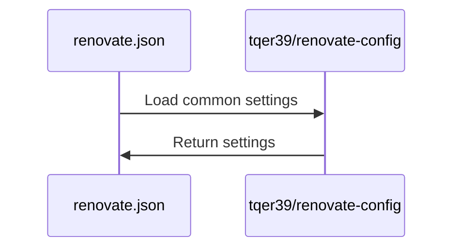

<p align="center">
  <a href="">
    
  </a>
  <h1 align="center">Renovate Config</h1>
</p>

<p align="center">
  <i>This repository is a repository that allows you to refer to and use Renovate configuration files from multiple repositories by consolidating them.</i>
</p>

---

## Usage

1. Create a `renovate.json` file in the root directory of your project.
2. Add the following settings to the `renovate.json` file.

```json
{
  "extends": [
    "github>tqer39/renovate-config"
  ]
}
```

## Customize settings for each repository

1. Create a `renovate.json` file in the root directory of your project.
2. Add the following settings to the `renovate.json` file.

```json
{
  "extends": [
    "github>tqer39/renovate-config"
  ],
  "packageRules": [
    {
      "packagePatterns": ["^@tqer39/"],
      "automerge": true
    }
  ]
}
```

### If you want to customize the common settings of this repository for your own use

1. Fork this repository.
2. Add the settings to the `renovate.json` file using the URL of the forked repository.

```json
{
  "extends": [
    "github>Your GitHub username/renovate-config"
  ]
}
```

## Processing contents



## Description of Renovate settings

The configuration file cannot be placed anywhere other than the root of the repository.

| File Name | Description |
| --------- | ----------- |
| [default.json](./default.json) | Entry point for external repositories. Extends `renovate.json5`. |
| [renovate.json5](./renovate.json5) | Main configuration file containing all Renovate settings. |

### Main configuration options in `renovate.json5`

| Option | Description |
| ------ | ----------- |
| `extends` | Base presets: `config:recommended` (Renovate 推奨設定), `helpers:pinGitHubActionDigests` (GitHub Actions のバージョン指定をコミット SHA にピン留めし、サプライチェーン攻撃を防止) |
| `timezone` | Time zone setting (`Asia/Tokyo`) |
| `schedule` | Update check schedule (weekends 0:00-6:00) |
| `automerge` | Auto-merge enabled for PRs |
| `automergeSchedule` | Auto-merge schedule (weekdays 0:00-6:00) |
| `automergeStrategy` | Merge strategy (`squash`) |
| `automergeType` | Auto-merge type (`pr`) |
| `platformAutomerge` | Enable platform-level auto-merge |
| `prHourlyLimit` | PR creation rate limit (`0` = unlimited) |
| `separateMajorMinor` | Separate major and minor update PRs |
| `separateMultipleMajor` | Create separate PRs for each major version bump |
| `dependencyDashboard` | Enable dependency dashboard |
| `labels` | PR labels: base `renovate`, plus one of `major`/`minor`/`patch` based on update type |
| `minimumReleaseAge` | Wait 14 days before proposing ordinary releases |
| `minimumReleaseAgeBehaviour` | Require a release timestamp; hold updates with unknown publication dates |
| `internalChecksFilter` | Strict filtering prevents branches and PRs before the waiting period passes |
| `ignoreScripts` / `ignorePlugins` | Disable supported package manager scripts and Composer plugins during Renovate lockfile updates |
| `osvVulnerabilityAlerts` | Enable experimental OSV alerts for supported direct dependencies |
| `vulnerabilityAlerts` | Security vulnerability alerts with auto-merge and `security` label |
| `packageRules` | Package-specific rules for GitHub Actions, Node.js, Python, etc. |

### Supply chain protection

Ordinary releases wait 14 days. Major updates and replacements require manual merging. Updates without a release timestamp remain pending in the Dependency Dashboard, including digest updates when their datasource cannot supply a timestamp.

Initial digest pinning (`pinDigest`) bypasses the age check so a missing release timestamp does not block the manual-review PR. Manual merging is required; verify the pinned commit or image digest and package provenance. Subsequent digest updates (`digest`) retain the 14-day waiting period and timestamp requirement.

Renovate [cannot enforce release age](https://docs.renovatebot.com/key-concepts/minimum-release-age/) for `pin`, `replacement`, `lockFileMaintenance`, `lockfileUpdate`, `rollback`, or `bump` updates. These updates bypass the age check and require manual merging, with a review reminder in the PR. Review the full lockfile diff and transitive dependencies: a mature direct dependency can still resolve to newly published transitive packages. Configure release-age restrictions in the consumer's package manager and CI as well.

Vulnerability fixes retain automatic merging and bypass the waiting period (`minimumReleaseAge: null`) and update schedule. Enable GitHub Dependency graph and Dependabot alerts, and grant Renovate read access to alerts. [OSV detection](https://docs.renovatebot.com/configuration-options/#osvvulnerabilityalerts) is experimental and covers supported direct dependencies; it does not guarantee detection of unknown malicious code.

`ignoreScripts: true` and `ignorePlugins: true` restrict execution during Renovate's supported lockfile updates. They do not configure consumer CI. For self-hosted Renovate, keep `allowScripts: false`, `allowPlugins: false`, and `allowedCommands: []` in the [administrator configuration](https://docs.renovatebot.com/self-hosted-configuration/). `allowedPostUpgradeCommands` is the former name of `allowedCommands`; neither option belongs in a repository preset.

Keep required CI checks and branch protection enabled in each consumer repository. Consumers can override this shared preset; review any exceptions. The waiting period and SHA pinning reduce risk but cannot guarantee that a package or Action is safe.

## Development

このリポジトリの pre-commit フックは [lefthook](https://lefthook.dev/) で管理する。

### セットアップ

```bash
mise install          # lefthook / actionlint / shellcheck / biome / node を導入
lefthook install      # .git/hooks/pre-commit に lefthook を登録
```

### ローカルで全ファイル検査

```bash
lefthook run pre-commit --all-files
```

The Renovate hook uses version `44.149.1`, disables installation scripts, validates both preset files as repository configuration, and runs regression tests with Renovate's rule engine. Run it independently with:

```bash
lefthook run pre-commit --all-files --job renovate-config-validator
```

## Contribution

If you find any issues or have improvements, please create an Issue or submit a Pull Request.

## License

This project is licensed under the [MIT License](LICENSE).
