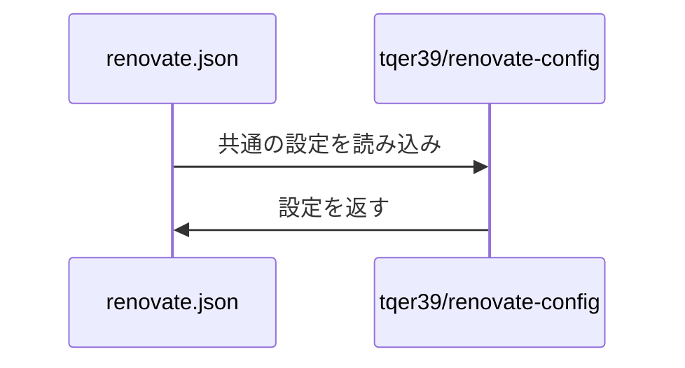

<p align="center">
  <a href="">
    
  </a>
  <h1 align="center">Renovate 共通設定</h1>
</p>

<p align="center">
  <i>Renovate の設定を共通化し、複数のリポジトリから参照して利用できるようにまとめたリポジトリです。</i>
</p>

## 使い方

1. プロジェクトのルートディレクトリに `renovate.json` ファイルを作成します。
2. 以下のように `renovate.json` ファイルに設定を追加します。

```json
{
  "extends": [
    "github>tqer39/renovate-config"
  ]
}
```

## リポジトリごとに設定をカスタマイズする場合

1. プロジェクトのルートディレクトリに `renovate.json` ファイルを作成します。
2. 以下のように `renovate.json` ファイルに設定を追加します。

```json
{
  "extends": [
    "github>tqer39/renovate-config"
  ],
  "packageRules": [
    {
      "packagePatterns": ["^@tqer39/"],
      "automerge": true
    }
  ]
}
```

### このリポジトリの共通設定を自分用にカスタマイズして使う場合

1. このリポジトリをフォークします。
2. フォークしたリポジトリの URL を使って `renovate.json` ファイルに設定を追加します。

```json
{
  "extends": [
    "github>あなたのGitHubユーザー名/renovate-config"
  ]
}
```

## 処理内容



## Renovate 設定の説明

設定ファイルはリポジトリのルート以外では配置できません。

| ファイル名 | 説明 |
| --------- | ----------- |
| [default.json](../default.json) | 外部リポジトリ用のエントリーポイント。`renovate.json5` を継承します。 |
| [renovate.json5](../renovate.json5) | すべての Renovate 設定を含むメイン設定ファイル。 |

### `renovate.json5` の主要な設定項目

| オプション | 説明 |
| ------ | ----------- |
| `timezone` | タイムゾーン設定 (Asia/Tokyo) |
| `schedule` | 更新チェックのスケジュール (週末 0:00-6:00) |
| `automerge` | PR の自動マージ設定 |
| `automergeSchedule` | 自動マージのスケジュール (平日 0:00-6:00) |
| `automergeStrategy` | マージ戦略 (squash) |
| `platformAutomerge` | プラットフォームレベルの自動マージを有効化 |
| `separateMajorMinor` | メジャーとマイナーの更新 PR を分離 |
| `dependencyDashboard` | 依存関係ダッシュボードを有効化 |
| `vulnerabilityAlerts` | セキュリティ脆弱性アラート設定 |
| `packageRules` | GitHub Actions、Node.js、React、Vite/Vitest、Cloudflare Workers、Python などのパッケージ固有ルール |

npm の minor・patch 更新は、React（型定義を含む）、Vite と Vitest、Cloudflare Workers のツール群（`wrangler`、`@cloudflare/workers-types`、`@cloudflare/vitest-pool-workers`）ごとにまとめます。メジャー更新は引き続き手動レビューが必要です。これらのルールは kazokubi を含む、デフォルトプリセットを参照するリポジトリに適用されます。

### サプライチェーン攻撃対策

- 通常のリリースは `minimumReleaseAge: "14 days"` で14日間待機します。`internalChecksFilter: "strict"` により、待機中はブランチや PR を作成しません。
- `minimumReleaseAgeBehaviour: "timestamp-required"` により、公開日時が不明な更新を保留します。日時を取得できないダイジェスト更新も Dependency Dashboard で保留されます。
- メジャー更新と依存置換は手動マージが必要です。
- 初回の SHA 固定（`pinDigest`）は、公開日時が不明でも手動レビュー用の PR を作成できるように待機検査を解除します。手動マージを必須とし、固定先のコミットやイメージダイジェストと入手元を確認してください。固定後のダイジェスト更新（`digest`）には14日待機と公開日時の必須条件を維持します。
- `pin`、`replacement`、`lockFileMaintenance`、`lockfileUpdate`、`rollback`、`bump` は [公開後の経過時間を検査できません](https://docs.renovatebot.com/key-concepts/minimum-release-age/)。これらは待機期間の検査を解除し、PR に確認事項を表示して手動マージを必須にします。
- 脆弱性修正は従来どおり自動マージを維持し、`minimumReleaseAge: null` で待機を解除します。更新スケジュールも回避します。利用先で GitHub の Dependency graph と Dependabot alerts を有効にし、Renovate にアラートの読み取り権限を与えてください。
- [OSV による検知](https://docs.renovatebot.com/configuration-options/#osvvulnerabilityalerts) は実験的機能で、対応する直接依存が対象です。未知の悪意あるコードを必ず検知できるわけではありません。
- `ignoreScripts: true` と `ignorePlugins: true` で、Renovate が対応するロックファイル更新時のパッケージスクリプトと Composer プラグインを無効にします。

ロックファイル全体の差分と間接依存も確認してください。直接依存が14日経過していても、新しい間接依存が取り込まれる可能性があります。利用先のパッケージマネージャーと CI にも公開後の待機期間やスクリプト実行制限を設定してください。このプリセットの設定は利用先の CI に適用されません。

セルフホストの場合は、[管理者設定](https://docs.renovatebot.com/self-hosted-configuration/) に `allowScripts: false`、`allowPlugins: false`、`allowedCommands: []` を設定してください。`allowedPostUpgradeCommands` は `allowedCommands` の旧名で、どちらも共有プリセットでは有効になりません。

利用先の必須 CI チェックとブランチ保護も設定してください。利用先の設定は共有プリセットを上書きできるため、例外設定もレビューが必要です。待機期間と GitHub Actions の SHA 固定はリスクを減らしますが、安全性を保証するものではありません。

## 貢献方法

問題や課題が発見されたら Issue を作成するか Pull Request を作成していただけると幸いです。

## ライセンス

このプロジェクトは [MIT ライセンス](LICENSE) の下でライセンスされています。
